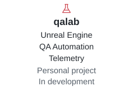
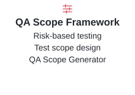
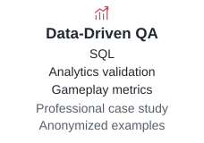

<strong>Lead QA Engineer</strong>

  <picture>
    <source media="(prefers-color-scheme: dark)" srcset="README_PICTURES/signature-dark.svg">
    
  </picture>

<strong>Technical QA / Gameplay Systems</strong> <a href="https://dianagrigorovich.com">dianagrigorovich.com</a>

---

<h3 align="center">The Art of Quality</h3>

I design reproducible approaches to gameplay validation, combining automation, telemetry and systems analysis.

  <a href="https://dianagrigorovich.com"><picture><source media="(prefers-color-scheme: dark)" srcset="README_PICTURES/link-portfolio-dark.svg"></picture></a>
  <a href="https://drive.google.com/file/d/1K3TkqTpBi2SRU_xLZV1KQP14BczJbTe8/view?usp=sharing"><picture><source media="(prefers-color-scheme: dark)" srcset="README_PICTURES/link-resume-dark.svg"></picture></a>
  <a href="https://www.linkedin.com/in/diana-grigorovich/"><picture><source media="(prefers-color-scheme: dark)" srcset="README_PICTURES/link-linkedin-dark.svg"></picture></a>

<h3 align="center">Selected Work</h3>

  <a href="https://dianagrigorovich.com/projects/qalab/"><picture><source media="(prefers-color-scheme: dark)" srcset="README_PICTURES/project-qalab-dark.svg"></picture></a>
  <a href="https://dianagrigorovich.com/projects/testing-scope-framework/"><picture><source media="(prefers-color-scheme: dark)" srcset="README_PICTURES/project-scope-dark.svg"></picture></a>
  <a href="https://dianagrigorovich.com/projects/analytical-driven-qa/"><picture><source media="(prefers-color-scheme: dark)" srcset="README_PICTURES/project-data-dark.svg"></picture></a>

 

Tbilisi, Georgia

